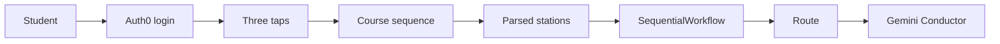

# Majorly Lost

A student at Miami Dade College picks a career and gets the stops between here and that job. The map is the official course sequence. Swarms writes the ticket copy. Gemini answers questions as the Conductor. Login is Auth0.

## What the demo does

Sign in, answer three taps (career, pace, starting point), and generate. The server loads that program's Course Sequence Guide. Stations are parsed from that text, so a model cannot add a course. One `SequentialWorkflow` of three agents then writes the why, the certificates, and three resume bullets. The fare stub shows `status`, `job_id`, `execution_time`, tokens, and `usage.total_cost`. If that call fails, the stations still render and the fare stub shows the error.

The Conductor is `POST /api/chat`. It may only mention course codes that appear in the sequence.

## Career sources

The live source is the CurriQunet catalog at `https://mdc.curricunet.com`. MDC has no course API. "Live" means the server reads the 2026-2028 Course Sequence Guide when the student generates a route, then the course-sequence PDF, then `data/csg/*.txt`.

- Associate in Science in Cybersecurity. Sentinel CTS 1134.
- Bachelor of Science in Cybersecurity. Sentinel CIS 3215.
- Associate in Science in Culinary Arts Management. Sentinel FSS 1200.
- Associate in Arts in Architecture. Sentinel ARC 1115.
- Associate in Science in Architectural Design and Construction Technology. The catalog page is empty, so this fork starts at its PDF extract in `data/csg/arch-as.txt`.
- Associate in Arts in Engineering - Mechanical. Sentinel EGN 1008C. Transfer path toward a bachelor's and the FE exam.
- Associate in Science in Computer Information Technology. Sentinel CTS 1134.
- Associate in Arts in Computer Information Systems. Sentinel CGS 1060C.

PDF fallbacks:

- AS Cybersecurity: `https://www.mdc.edu/academics/programs/csg/AS_Cybersecurity_csg.pdf`
- BS Cybersecurity: `https://www.mdc.edu/academics/programs/csg/BS_Cybersecurity_csg.pdf`
- AS Culinary Arts Management: `https://www.mdc.edu/academics/programs/csg/AS_CulinaryArtsManagement_csg.pdf`
- AA Engineering - Mechanical: `https://www.mdc.edu/academics/programs/csg/AA_Engineering-Mechanical_csg.pdf`
- AA Architecture: `https://www.mdc.edu/academics/programs/csg/2025/AA_Architecture_csg.pdf`
- AS Architectural Design and Construction Technology: `https://www.mdc.edu/academics/programs/csg/AS_ArchitecturalDesign%26ConstructionTechnology_csg.pdf`
- AS Computer Information Technology: `https://www.mdc.edu/academics/programs/csg/AS_ComputerInformationTechnology_csg.pdf`
- AA Computer Information Systems: `https://www.mdc.edu/academics/programs/csg/AA_ComputerInformationSystems_csg.pdf`

`shortcut: localStorage only, add a database when the same roadmap must follow the student to another device.`

## App shape

- `app/page.tsx` — landing map. Get my ticket goes to Auth0, then the planner.
- `app/dashboard/page.tsx` — three taps, then the route. Protected.
- `app/api/pathway/route.ts` — session, sequence, parsed stations, swarm. `maxDuration` stays 300.
- `app/api/chat/route.ts` — Gemini Conductor.
- `lib/roadmap-doc.ts` — catalog grammar and the architecture PDF grammar.
- `lib/careers.ts`, `lib/catalog.ts`, `lib/swarm.ts`, `lib/gemini.ts` — choices, sequence loading, swarm call, course-code guard.

Tests: `npm test` runs `node --experimental-strip-types --test test/*.ts`.
